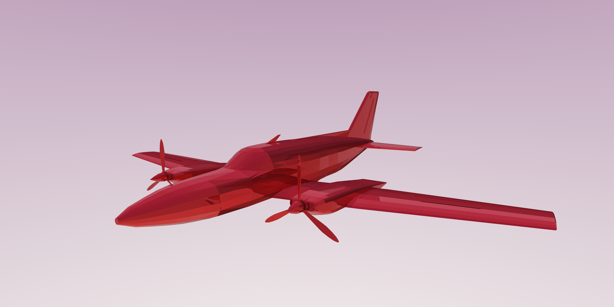

# Spectral

A physically-based path tracer built off of my [initial pass](https://github.com/yannajask/raytracer) at Ray Tracing in One Weekend, and inspired heavily by PBRT. Mostly serves as my playground for trying out new things I find online, so some things might be implemented out of order.

## Features

- Principled Disney BSDF
- Spatial acceleration via BVH trees
- Sampling optimizations:
  - Adaptive multi-sampling
  - Multithreading with OpenMP
  - Russian roulette termination
- Basic OBJ mesh loader

### To-do

Nowadays I am more interested in GPU-accelerated graphics, but I still have a few features I'd like to implement:

- [ ] Normal mapping
- [ ] Texture mapping
- [ ] MTL file support

## References

- [Ray Tracing in One Weekend](https://raytracing.github.io/books/RayTracingInOneWeekend.html)
- [Physically Based Rendering](https://www.pbr-book.org/3ed-2018/Introduction)
- [Scratchapixel](https://www.scratchapixel.com/)
- [Original Disney BRDF paper](https://media.disneyanimation.com/uploads/production/publication_asset/48/asset/s2012_pbs_disney_brdf_notes_v3.pdf)
- [Disney BSDF paper](https://blog.selfshadow.com/publications/s2015-shading-course/burley/s2015_pbs_disney_bsdf_notes.pdf)
- [UCSD Disney BSDF assignment](https://cseweb.ucsd.edu/~tzli/cse272/wi2023/homework1.pdf)
- [A blog on implementing the Disney BSDF](https://schuttejoe.github.io/post/disneybsdf/)
